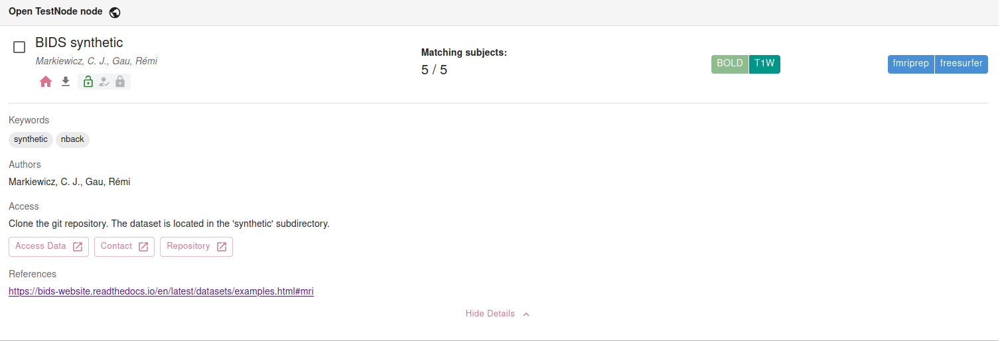

To generate harmonized data using Neurobagel, you must prepare a dataset description file.
This is a [JSON](https://www.w3schools.com/whatis/whatis_json.asp) file that includes [specific fields](#dataset-description-fields) describing the dataset and how to access the data.
This file is adapted from the [BIDS `dataset_description.json`](https://bids-specification.readthedocs.io/en/stable/modality-agnostic-files/dataset-description.html#dataset-description).

Information from the dataset description will be displayed to a user when they discover your dataset in the Neurobagel query tool.

!!! tip
	You can generate this file automatically using the [Neurobagel annotation tool](https://annotate.neurobagel.org/).

## Example

!!! tip
	There is no required file name for your Neurobagel dataset description.
	We recommend using a descriptive file name such as `DATASETNAME_description.json`.

```json
--8<-- "https://raw.githubusercontent.com/neurobagel/neurobagel_examples/refs/heads/main/data-upload/synthetic_dataset_description.json"
```

How this dataset info will appear in the query tool:



## Dataset description fields

Neurobagel recognizes the following fields in the dataset description JSON file. Extra keys are ignored. <sup>†</sup> indicates a key adopted from the BIDS [`dataset_description.json`](https://bids-specification.readthedocs.io/en/stable/modality-agnostic-files/dataset-description.html).

Key name | Requirement level | Data type | Description
---- | ---- | ---- | ----
Name<sup>†</sup> | REQUIRED | string | Name of the dataset. This name will be displayed when users discover the dataset in a Neurobagel query.
Authors<sup>†</sup> | RECOMMENDED | list of strings | List of individuals who contributed to the creation/curation of the dataset.
ReferencesAndLinks<sup>†</sup> | RECOMMENDED | list of strings | List of links or references that contain information on the dataset. **NOTE:** The first valid URL in this list will also be used as the dataset homepage when the dataset is discovered in the Neurobagel query tool.
Keywords<sup>†</sup> | RECOMMENDED | list of strings | List of keywords describing the content or subject matter of the dataset.
RepositoryURL | RECOMMENDED | string | URL to a repository where the dataset can be downloaded or retrieved from (e.g., DataLad, Zenodo, GitHub).
AccessInstructions | RECOMMENDED | string | Description of how to access the data.
AccessType | RECOMMENDED | string, one of: `"public"`, `"registered"`, `"restricted"` | Level of requirements for accessing the data. `public`: Immediately accessible without registration, authentication, or approval. `registered`: Requires authentication or agreement to basic terms of use, but no formal application or review. `restricted`: Requires formal approval or review of a data access request.
AccessEmail | RECOMMENDED | string (email) | Primary email for access requests.
AccessLink | RECOMMENDED | string | Primary link for access requests or information.

!!! note
	If you are [reusing the `dataset_description.json` from a BIDS dataset](#reusing-a-bids-dataset_descriptionjson), your JSON file may have additional, BIDS-specific fields not listed here.

## Reusing a BIDS `dataset_description.json`

If you have a BIDS dataset, your existing valid BIDS `dataset_description.json` can be directly used for Neurobagel without modification,
but we strongly recommend **adding** the optional Neurobagel-supported keys to improve dataset [FAIRness](https://www.go-fair.org/fair-principles/) and dataset discoverability in Neurobagel:

- `"RepositoryURL"`
- `"AccessInstructions"`
- `"AccessType"`
- `"AccessEmail"`
- `"AccessLink"`

(These additional fields will not make the `dataset_description.json` invalid for BIDS and will be safely ignored by the BIDS validator.)

!!! tip
	We recommend creating a copy of your BIDS `dataset_description.json` and adding Neurobagel-supported keys as needed.
